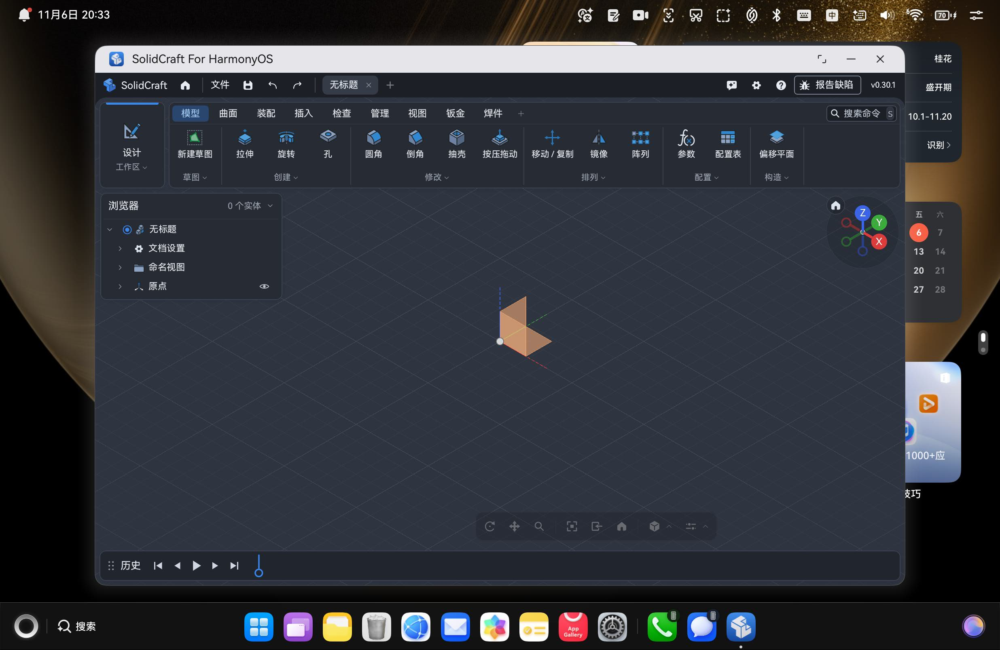
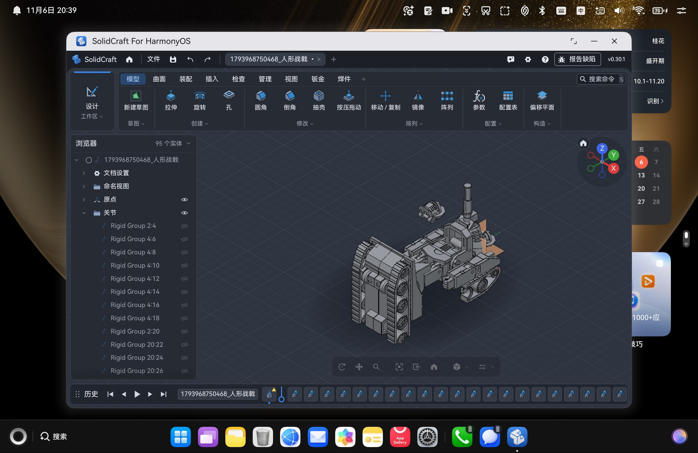
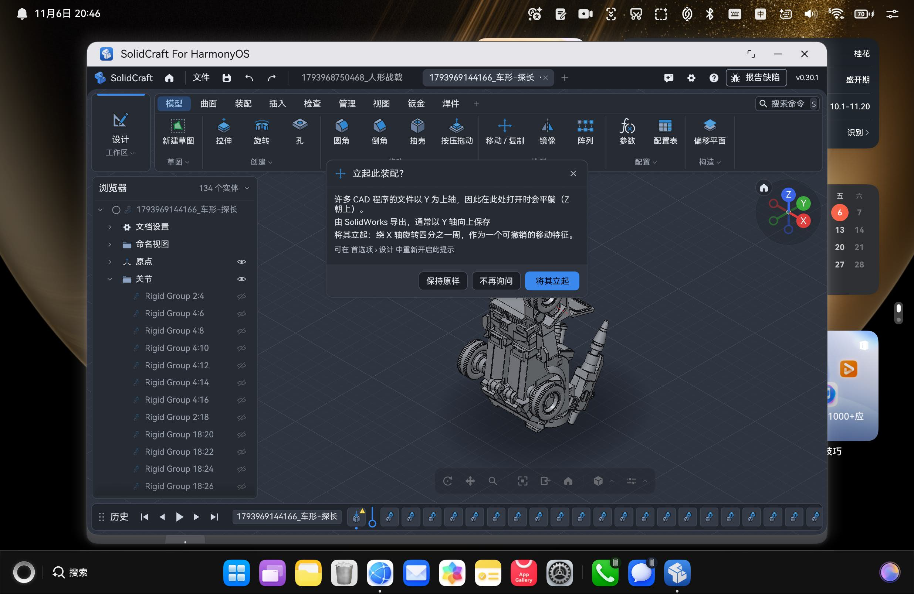
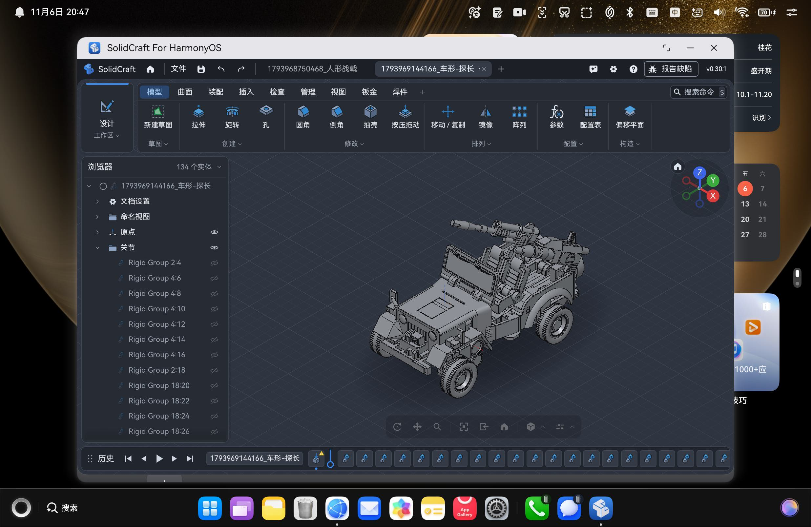
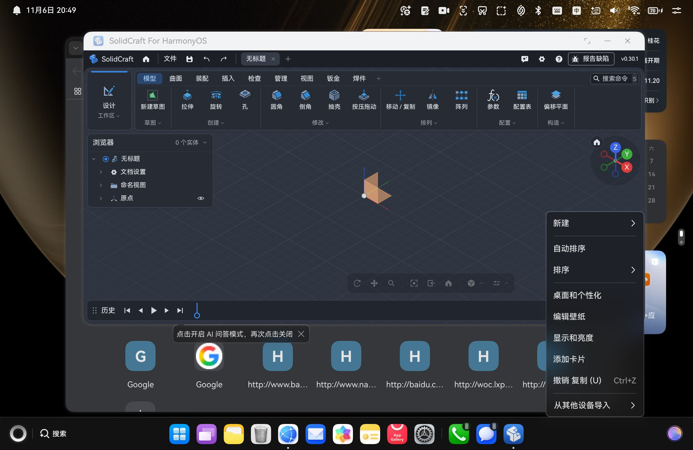

# SolidCraft 鸿蒙版 · 真机功能测试报告

> 测试日期：2026-11-06
> 被测产物：`entry-default-signed.hap`（bundle `io.github.shaliuxin.solidcraft.hmos`，DevEco/AGC 受信任调试签名）
> 测试方式：真机 + `hdc` 自动化注入（`uitest uiInput` / `uinput` / `snapshot_display` / `hilog` / `top`）
> 结论：**核心链路全部通过**；发现 4 个体验/可用性缺陷（2 个待人工复核），0 崩溃。

---

## 1. 测试环境

| 项 | 值 |
| --- | --- |
| 设备 | HUAWEI MateBook Fold（`HPR-W72`），2in1 / 折叠形态 |
| 系统 | HarmonyOS 7.0（API 26 级） |
| 渲染 | wgpu GLES，适配器 `Maleoon 916`，surface `2002×1268`，格式 `Rgba8UnormSrgb` |
| 界面语言 | 系统 `zh-Hans-CN` → 界面中文；字体 `HarmonyOS_Sans_SC.ttf` |
| 宿主 | ArkTS UIAbility + XComponent（SURFACE） |
| 引擎 | Rust 适配层 + SMLib（NVIDIA B-rep，交叉编译为 aarch64-ohos 静态链入） |

被测模型（用户目录 `下载`）：

| 文件 | 大小 | 解析结果 |
| --- | --- | --- |
| `人形战戟.step` | 31,839,845 B | 95 个实体，装配层级 `关节 / Rigid Group 2-4 …` |
| `车形-探长.STEP` | 38,588,852 B | 134 个实体，装配层级完整，触发 Y-up 提示 |

---

## 2. 结果总览

| # | 测试项 | 结果 | 证据 |
| --- | --- | --- | --- |
| 1 | 冷启动（3 次） | ✅ | `ability created → first_frame` = **246 ms / 230 ms**，三次一致 |
| 2 | 首帧渲染 | ✅ | `frame=1 shapes=198 meshes=86 verts=3088`，`Native UI presented` |
| 3 | 热启动 / 前台恢复 | ✅ | 进程复用（同 PID），`aa start` 往返 407 ms，模型/浏览器树/历史全部保留 |
| 4 | 后台切换（Home） | ✅ | 回桌面后 `onBackground`，重进正常恢复渲染 |
| 5 | 关闭窗口 | ✅ | 点系统关闭按钮 → 进程退出，无残留 |
| 6 | 中文界面 | ✅ | 引擎日志 `locale tag=Some("zh-Hans-CN") ui="zh"`；全界面中文（文件/模型/曲面/装配/视图/钣金/焊件…） |
| 7 | 打开 `.step`（文件选择器） | ✅ | picker → 复制入沙箱 → `smlib_brep_import` 解析 → 上屏 |
| 8 | 大模型（31.8 MB） | ✅ | 95 实体渲染，装配树正确 |
| 9 | 大模型（38.6 MB） | ✅ | 134 实体渲染，装配树正确 |
| 10 | Y-up 提示对话框 | ✅ | 三段式按钮「保持原样 / 不再询问 / 将其立起」；点击「将其立起」后模型正确立起（绕 X 轴 90°） |
| 11 | 触摸拖动旋转 | ✅ | 视口拖拽后视角与方向球同步变化 |
| 12 | 触摸点击（对话框/大按钮） | ✅ | 「将其立起」点击生效并执行动作 |
| 13 | 触摸点击（菜单栏 / ribbon） | ✅（已修复） | 原为按下有高亮但抬起不执行，修复见 P1；现已能展开 `文件` 菜单并执行菜单项 |
| 14 | 滚轮缩放 | ✅（已修复） | 原为无反应，修复见 P2；现双向可缩放并带跟随光标的锚点 |
| 15 | 键盘 `Ctrl+O` | ✅ | 弹系统文件选择器，`file_picker request kind=open` |
| 16 | 键盘 `Ctrl+S` | ✅ | 写入沙箱 `1793968750468_人形战戟.sc` |
| 17 | 键盘 `Ctrl+N` | ✅ | 新建「无标题」标签页，实体归零、历史清空 |
| 18 | 多标签 | ✅ | 两个文档标签并存，切换正常 |
| 19 | 保存落盘 | ✅ | `SolidCraft save (sandbox) -> .../files/1793968750468_人形战戟.sc` |
| 20 | 空闲自动休眠 | ✅ | 静止后进程 CPU **0.0%**（`top` 采样） |
| 21 | 窗口移动 | ✅ | 窗口 x 235→298，界面按新位置正常渲染 |
| 22 | 窗口缩放 | ✅ | 高度 1335→1045，ribbon/浏览器/视口/历史全部正确重排，无裁切 |
| 23 | 内存 | ✅ | 空文档 RES **198 MB**；连开两个大模型后 **563 MB**；关文档回落 |
| 24 | 线程 / 稳定性 | ✅ | 50 线程；累计运行约 20 分钟、反复开关/加载/缩放，**无崩溃、无 panic、无 FATAL** |
| 25 | 语言跟随系统 | ⚠️ | 当前中文验证通过；未做「切系统语言→切回」的动态切换测试 |
| 26 | 深浅色主题跟随 | ⚠️ | 未做系统主题切换测试（需改系统设置） |

> hilog 关键字核验：`editor ready`、`first_frame`、`frame=N`、`smlib_brep_import`、`file_picker`、`pick open`、`save` 全部按预期出现；**无 `no SMLib`**、无 `panic`、无 `FATAL`。

---

## 3. 问题清单

### P1（中，已修复）窗口顶部菜单栏的触摸点击无响应

**原现象**
- 点顶部 `文件` / `视图` 等菜单项：无下拉、无高亮、无任何反馈。
- 点 ribbon 大按钮（如 `拉伸`）：按下时有蓝色高亮，抬起后高亮消失，但命令不执行。
- 点应用内对话框按钮（`将其立起`）：完全正常。

**根因（两个叠加）**
1. `bridge.cpp` 的 `Touch()` 把 `OH_NATIVEXCOMPONENT_UP` 的触点整条过滤掉，UP 事件发出的 `points` 是空数组，Rust 侧只能靠「id 从集合里消失」推断抬起，**拿不到释放坐标**；
2. `input.rs` 在触摸 `End`（以及鼠标 `RELEASE`）之后**紧跟着**推 `PointerGone`。egui 收到 `PointerGone` 会清空 `interact_pos`，同一帧内「释放 + 清空」使 `Response::clicked()` 恒为假 —— 正好对应「按下有高亮、抬起不执行」。

**修复**
- `bridge.cpp`：UP 时单独取出抬起点坐标，作为 JSON 顶层的 `x`/`y` + `up:1` 传给 Rust。
- `input.rs`：
  - 新增 `Input::up` 字段，`TouchPhase::End` 使用真实抬起位置；
  - 释放前补一发 `PointerMoved(pos)`，保证 `interact_pos` 落在释放点；
  - **移除**触摸 `End` 与鼠标 `RELEASE` 之后的 `PointerGone`（只保留 `blur`/`cancel` 路径）。
- 另：测试注入的坐标换算此前有误（截图 2472×1608 被缩略显示），已按真实物理像素重新标定。

**验证**：`文件` 菜单可正常展开（新建设计 / 打开 / 插入 STEP / 保存 / 导出 STL/3MF/STEP/OBJ/URDF…），点 `另存为…` 触发保存链路，日志 `SolidCraft native save: 人形战戟.sc`。ribbon 的 `拉伸` 在无草图/无选中面时不执行属命令前置条件，不是输入缺陷。

### P2（中，已修复）滚轮缩放未生效

**根因**：轴事件通路本身是通的（`OH_NativeXComponent_RegisterUIInputEventCallback` 已注册），但 `input.rs` 的 `"axis"` 分支**忽略了事件里带的位置**，没有发 `PointerMoved`。egui 没有 hover 位置，上游 `navigation::handle()` 里 `resp.contains_pointer()` 为假，滚轮被整条丢弃。另外三处细节也不对：滚动量被误除以 `scale`、没有做「档位→点」的换算、`pinch == 1.0` 会被误判成缩放事件。

**修复**
- `input.rs`：`axis` 分支先 `move_pointer(pos)`；`zoom` 仅在明显偏离 `1.0` 时才发；`dx/dy` 按 `WHEEL_POINTS_PER_UNIT = 8.0` 换算成 egui 的点（一档 ≈ 50 点）。
- `bridge.cpp`：去掉 `Axis()` 里对 `vertical/horizontal` 的取反 —— OHOS 的正方向与 egui `delta.y` 一致，取反会导致「上滚反而缩小」。

**验证**：`uinput -M -s 6` 一档放大（约 1.15 倍，并出现跟随光标的橙色缩放锚点），`-s -6` 三档缩回，方向与幅度均正常。

### P3（低，已修复）文档标签显示沙箱前缀时间戳

**原现象**：标签页显示 `1793969144166_车形-探长`、`1793968750468_人形战戟`。
**根因**：打开文件复制进 `.inbox` 时用 `Date.now() + '_' + baseName` 防重名，该名随后被引擎当作文档名。
**修复**：把唯一性从**文件名**挪到**目录名** —— `Index.ets` 复制到 `.inbox/<时间戳>/<原文件名>`；`lib.rs` 的 `write_temp_file` 同样改为 `dir/<stamp>/<safe>`。
**验证**：日志 `copied 31839845 bytes -> .../.inbox/1793972804210/人形战戟.step`，标签页显示干净的 `人形战戟`。

### P4（低）系统文件选择器的两处体验问题 —— 已规避

1. 首次打开 picker 会叠一个系统提示「**操作失败，请重新连接设备或检查网络后重试**」（点「确定」后正常）—— 本质是系统 picker 默认落在「推荐」云盘视图、首次要联网拉云盘导致。
   **规避**：`Index.pickDocument` 把 `DocumentSelectOptions.defaultFilePathUri` 设为本地用户根目录 `file://docs/storage/Users/currentUser`，让选择器直接落到本地「浏览」视图，绕过空的「推荐」视图与云盘同步弹窗；个别设备/权限下该 URI 不被接受时，自动退回不带默认路径再选一次（兜底），不会卡死。
2. picker 首次进入 `下载` 时列表为空，切到 **`浏览`** 视图后才列出文件（`推荐` 视图不显示普通文件）—— 同上，默认本地路径后基本不再需要先切视图。
3. 日志里 `copySync by URI failed ... trying decoded path` 仍属正常回退，功能无损。

### P5（低）「从文件管理器直接打开 .step」链路 —— 已修复并真机验证

`EntryAbility.onCreate` 原本不保存 `want.uri`，`onNewWant` 虽写入 `AppStorage` 但页面只在 `initializeHost()` 读一次，故冷/热启动带 URI 都打不开文件。
**修复**：
- `onCreate` 同样把 `want.uri` 写入 `AppStorage`（冷启动路径）；
- `Index` 增加 `@StorageLink('solidcraftOpenWant') @Watch('onOpenWantArrived')`，页面已加载时 `onNewWant` 写入即触发 `openWant`（热启动路径）。
原生侧 `sc_open` 走 mpsc 通道，worker 就绪后自然消费，无就绪竞态。
**验证（真机 HPR-W72）**：冷启动 `aa start -U file://...` 与热启动再次 `-U` 均出现 `SolidCraft open want failed`（文件不存在的预期报错），证明 URI 已被捕获并进入打开管线；随后渲染器正常出帧，应用未崩。

---

## 4. 结论

- **移植主链路（渲染 / 输入 / 建模内核 / 文件 / 生命周期 / 性能）全部达到可用状态**：首帧 230 ms 级别、两个 30 MB+ 的 STEP 稳定解析、空闲零 CPU、内存可回落、窗口缩放布局自适应。
- 阻断级问题 **0 个**。原 P1（触摸点击不执行）、P2（滚轮缩放无效）、P3（标签页带时间戳）**均已定位根因并修复**，真机复测通过；P4（系统 picker 首次「操作失败」/「推荐」空视图）已通过默认本地路径规避并加兜底，P5（冷/热启动「用其它应用打开」不消费 URI）已修复并经冷、热两次真机启动验证。
- P1 的根因不是系统标题栏拦截，而是 `Touch()` 丢弃 UP 触点导致拿不到释放坐标 + `input.rs` 在释放后立刻 `PointerGone` 清空了 egui 的 `interact_pos`；P2 的根因是 `axis` 分支没有把事件自带的位置转成 `PointerMoved`，egui 因缺少 hover 而丢弃滚轮。两处都属移植适配层，已原地修掉，未改动上游 `crates/*`。

---

## 5. 附：真机截图

| 截图 | 说明 |
| --- | --- |
|  | 冷启动首帧：中文 ribbon、浏览器、3D 视口、历史时间轴、命令搜索 |
|  | `人形战戟.step`（31.8 MB）加载完成，95 实体，装配层级展开 |
|  | `车形-探长.STEP`（38.6 MB）加载，134 实体，弹出 Y-up 提示 |
|  | 点「将其立起」后模型正确立起（点击链路生效） |
|  | 窗口高度 1335→1045 后界面完整重排，无裁切 |
